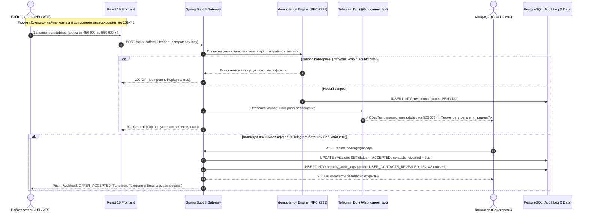
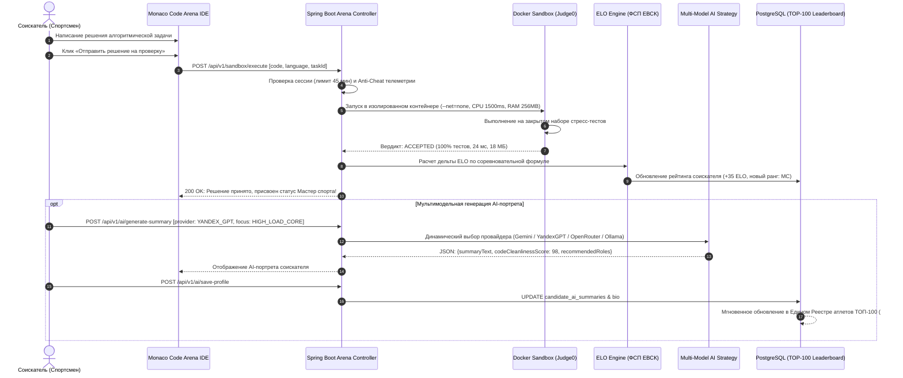

# Архитектурный манифест цифровой платформы «FSP Career Arena» (2026)
## Enterprise Architecture & Security Specification

Цифровая платформа-агрегатор ИТ-вакансий с обратной механикой найма и верифицированным профилем достижений **Федерации спортивного программирования России (ФСП РФ)**.

---

## 1. Концепция и Архитектурные принципы

Платформа спроектирована по принципам **Enterprise Highload**, **Zero-Trust Security** и **152-ФЗ РФ (Защита персональных данных)**:
1. **Обратный найм (Reverse Recruiting):** Работодатели первыми делают прозрачные офферы с фиксированной вилкой заработной платы на основе подтвержденных спортивных достижений и рейтинга ELO.
2. **Изолированное тестирование и Антифрод (Isolated Sandbox & Anti-Fraud):** Код соискателей компилируется и выполняется в строго изолированных контейнерах без доступа к внешней сети и с ограничением ресурсов.
3. **Идемпотентность критических операций (RFC 7231 / IETF Idempotency-Key):** Защита от дублирования офферов, списания слотов вакансий и повторных откликов при сетевых сбоях и дабл-кликах.
4. **Конфиденциальность 152-ФЗ РФ:** Персональные контактные данные соискателя (телефон, Telegram, email) маскируются на уровне Spring Data / DTO и демаскируются в ATS-панели работодателя только после обоюдного согласия соискателя с обязательной фиксацией в журнале аудита безопасности.

---

## 2. Антифрод-система и «песочница» для тестов с изоляцией

### 2.1. Модель угроз и цели изоляции
При прохождении соревновательных тестов в Арене и кастомных заданий от работодателей исключаются следующие риски:
* **Списывание и обращение к внешним сервисам:** отправка кода или условий задачи сторонним LLM, поисковикам или внешним серверам.
* **Подмена результатов (Tampering):** манипуляция локальным JavaScript-кодом в браузере или перехват сетевых запросов для отправки фиктивного вердикта `ACCEPTED`.
* **DoS и утечка памяти:** выполнение бесконечных циклов (`while(true)`), fork-бомб или аллокация терабайтов памяти.
* **Компрометация хост-системы:** попытка чтения файловой системы сервера или перехвата окружения других пользователей.

---

### 2.2. Архитектура изолированной Docker-песочницы (Judge0 / Sandbox Engine)

Каждая посылка кода компилируется и прогоняется в одноразовом изолированном контейнере:

```
[ Monaco IDE / Web ]  -- (Source Code + Language) --> [ Spring Boot 3 Core Backend ]
                                                              │
                                                      (Rate Limiting &
                                                       Session Timer 45m)
                                                              ▼
                                                   [ Sandbox Manager ]
                                                              │
                                            (Docker API / cgroups v2 / seccomp)
                                                              ▼
                                           ┌──────────────────────────────────────┐
                                           │   ИЗОЛИРОВАННАЯ DOCKER-ПЕСОЧНИЦА    │
                                           │ ───────────────────────────────────  │
                                           │  • Network: --net=none (No Internet) │
                                           │  • Memory Limit: 256 MB (cgroups)   │
                                           │  • CPU Time Limit: 1000-2000 ms      │
                                           │  • User: non-root (nobody:nogroup)  │
                                           │  • Filesystem: Read-Only rootfs      │
                                           │  • PIDs Limit: max 32 processes      │
                                           │  • Seccomp: blocked syscalls         │
                                           └──────────────────┬───────────────────┘
                                                              │
                                                        [ Execution ]
                                                              ▼
[ Candidate Dashboard / ATS ] <--- (Signed Verdict) <--- [ Verdict Validator ]
                                   (ACCEPTED / WA / TLE)   (Hidden Test Suites)
```

---

### 2.3. Ключевые параметры изоляции и регламент ограничений

| Параметр | Значение | Механизм обеспечения | Назначение |
|:---|:---|:---|:---|
| **Лимит времени сессии** | **45 минут** (настраиваемый таймер) | Серверный таймер в Redis/PostgreSQL | Защита от бесконечного обдумывания и растягивания тестового задания |
| **Лимит времени выполнения (CPU)** | **1000 – 2000 мс** на тест-кейс | Linux `setrlimit(RLIMIT_CPU)` + cgroups | Пресечение алгоритмически неоптимальных решений и зависаний |
| **Лимит оперативной памяти** | **128 – 256 МБ** | Linux `cgroups v2 memory.max` | Предотвращение исчерпания памяти хоста и OOM-паники |
| **Сетевая изоляция** | **Полное отключение (`--net=none`)** | Docker Network Namespace Isolation | Исключение сетевых сокетов, обращений к LLM, curl и внешним базам данных |
| **Файловая система** | **Read-Only Root FS + tmpfs 16MB** | Docker `--read-only`, `tmpfs /tmp:size=16M` | Исключение модификации бинарников и записи вредоносных скриптов |
| **Права процесса** | **Non-root (`nobody:65534`)** | Linux UID/GID drops + `CAP_DROP_ALL` | Защита от эскалации привилегий ядра |
| **Защита от fork-бомб** | **PIDs Limit: 32** | Linux `pids.max` controller | Блокировка рекурсивного создания процессов |

---

### 2.4. Антифрод-контроль и защита от подмены результатов

1. **Серверная валидация скрытых тест-кейсов (Hidden Test Suites):**
   * Браузер соискателя получает только базовые открытые примеры (Public Samples #1, #2).
   * Скрытые граничные и нагрузочные тесты (Hidden Stress Suites #3, #4, #5) хранятся исключительно на бэкенде в базе данных `algorithm_tasks` и инжектируются в контейнер на лету.
   * Вердикт (`ACCEPTED`, `WRONG_ANSWER`, `TIME_LIMIT_EXCEEDED`, `COMPILATION_ERROR`) вычисляется изолированным валидатором на сервере. Подделать вердикт через инспекцию страницы или изменение ответа невозможно.

2. **Телеметрия честности прохождения (Anti-Cheat Telemetry):**
   * Клиент отслеживает потерю фокуса вкладки (`window.blur`), переключение рабочих столов и попытки массовой вставки стороннего кода из буфера обмена (`onPaste` inspection).
   * События аномальной активности фиксируются в таблице `security_audit_logs` и передаются техлиду/рекрутеру при код-ревью в `TestReviewModal`.

3. **Криптографическая фиксация и неизменяемость посылок:**
   * Каждое решение кандидата сохраняется в таблице `task_submissions` с SHA-256 хэшем исходного кода, точным временем выполнения (`execution_time_ms`), пиковым потреблением памяти (`memory_used_kb`) и временной меткой.
   * Данные протокола тестирования не подлежат редактированию со стороны соискателя.

---

## 3. Идемпотентность API (RFC 7231 / IETF Idempotency-Key)

При отправке работодателем прямого оффера кандидату (`POST /api/v1/offers`):
* Клиент формирует заголовок `Idempotency-Key: idem-<uuid>`.
* Бэкенд проверяет уникальный индекс в БД и кэш `api_idempotency_records`:
  * При повторной отправке (сетевой таймаут, ретрай, повторный клик) запрос возвращает `HTTP 200 OK` с заголовком `Idempotent-Replayed: true` и сохраненным оффером.
  * Создание оффера-дубликата и повторные уведомления полностью блокируются.
  * Уникальный частичный индекс `(employer_id, candidate_id, vacancy_id) WHERE status = 'PENDING'` исключает дублирование на уровне схемы PostgreSQL.

---

## 4. Защита персональных данных (152-ФЗ РФ) и Журнал безопасности

1. **Маскирование контактов по умолчанию:**
   * Соискатель в выдаче поиска и топе лидеров отображается с замаскированными контактами: телефон `+7 (9**) ***-**-42`, email `i***v@yandex.ru`, Telegram `@a***v`.
2. **Обоюдное согласие:**
   * Контакты демаскируются исключительно после того, как кандидат нажал «Принять оффер».
3. **Журнал аудита доступа (`SecurityAuditLog`):**
   * Каждое раскрытие контактов работодателем логируется с фиксацией `actorUserId`, `actorEmail`, `targetCandidateId`, `ipAddress`, `userAgent` и временной метки.
   * Доступен HR-панели и регуляторам через модальное окно аудита и эндпоинт `GET /api/v1/audit/logs`.

---

## 5. Инфраструктурный стек

* **Runtime:** OpenJDK 21 (Temurin Alpine) + Node.js 20 LTS (Nginx Alpine)
* **Framework:** Spring Boot 3.3.4 (MVC, Data JPA, Security 6, WebClient)
* **Frontend:** React 19, TypeScript, Tailwind CSS, Monaco Editor
* **Database:** PostgreSQL 16 Alpine + Flyway Migrations (V1..V9)
* **Cache & Cooldowns:** Redis 7.2 Alpine
* **Sandbox Engine:** Judge0 CE / Docker Container Engine with cgroups v2
* **SSO Identity Provider:** Keycloak 24 Realm

---

## 6. Диаграммы последовательности (Mermaid Sequence Diagrams)

### 6.1. Жизненный цикл обратного найма, идемпотентного оффера и раскрытия контактов по 152-ФЗ



### 6.2. Проверка решения в Code Arena, расчет ELO и мультимодельный AI-портрет


