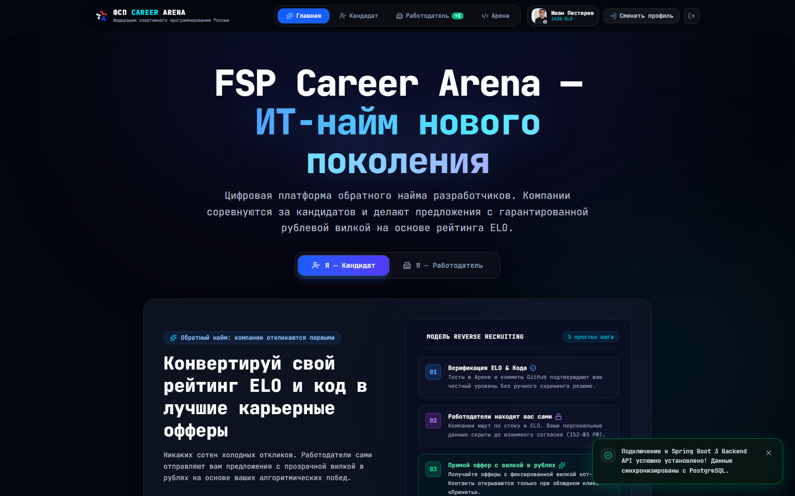
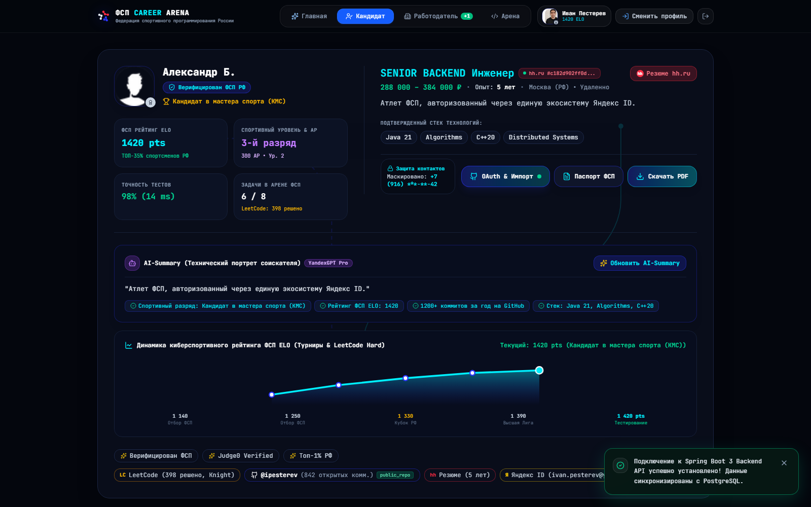
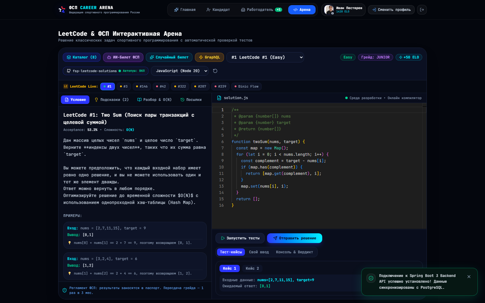
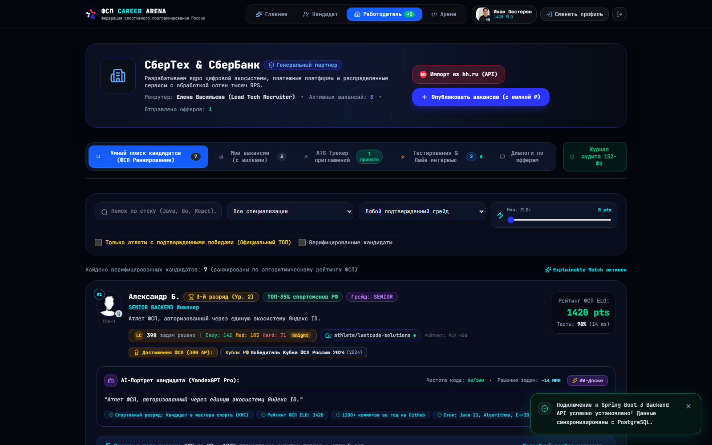

# ФСП Карьерная Арена (FSP Career Arena)

Платформа обратного найма («Reverse Recruiting») для ИТ-специалистов с верификацией спортивных достижений Федерации спортивного программирования России (ФСП РФ), объективным ELO-ранжированием, соревновательной Code Arena и защитой данных соискателей в режиме «Слепого найма» (152-ФЗ РФ).

[](https://huggingface.co/spaces/Linskay/demo-2026)
[](https://huggingface.co/spaces/Linskay/demo-2026)
[](https://linskay.github.io/fsp-2026/)
[](https://linskay-demo-2026.hf.space/swagger)
[](https://openjdk.org/projects/jdk/21/)
[](https://spring.io/projects/spring-boot)
[](https://react.dev/)
[](https://kotlinlang.org/)
[](https://github.com/linskay/fsp-2026/releases/latest)
[](https://linskay.github.io/fsp-2026/#security-privacy)

---

## 🌐 Демонстрационные стенды и ресурсы проекта

* **🚀 Онлайн-стенд платформы (24/7):** [https://huggingface.co/spaces/Linskay/demo-2026](https://huggingface.co/spaces/Linskay/demo-2026) *(прямой URL: [https://linskay-demo-2026.hf.space](https://linskay-demo-2026.hf.space))*
* **📖 Интерактивный портал документации (GitHub Pages):** [https://linskay.github.io/fsp-2026/](https://linskay.github.io/fsp-2026/)
* **📚 Спецификация REST API (Swagger UI):** [https://linskay-demo-2026.hf.space/swagger](https://linskay-demo-2026.hf.space/swagger)
* **📥 Официальный Манифест (PDF на русском языке):** [docs/MANIFEST.pdf](docs/MANIFEST.pdf) *(скачать с GitHub Pages: [MANIFEST.pdf](https://linskay.github.io/fsp-2026/MANIFEST.pdf))*
* **📱 Мобильное Android-приложение (APK):** [Скачать в GitHub Releases](https://github.com/linskay/fsp-2026/releases/latest) *(прямая ссылка: [fsp-career-arena.apk](https://linskay.github.io/fsp-2026/fsp-career-arena.apk))*

---

## 📸 Интерфейс платформы

| 🏠 Главная страница (Обратный найм) | 🏅 Личный кабинет атлета (Паспорт ФСП) |
| :---: | :---: |
| [](docs/images/landing_preview.png) | [](docs/images/candidate_dashboard.png) |
| *Модель Reverse Recruiting: офферы от компаний с зарплатными вилками* | *ELO 1420 pts, официальные разряды ЕВСК, LeetCode, GitHub и AI-портрет* |

| 💻 Интерактивная Code Arena IDE | 🏢 Дашборд работодателя («Слепой» наем) |
| :---: | :---: |
| [](docs/images/code_arena.png) | [](docs/images/employer_dashboard.png) |
| *Monaco Editor, запуск решений в песочнице Judge0, вердикты и тесты* | *Поиск по ELO, Zero-Bias режим «Слепого» найма, соблюдение 152-ФЗ РФ* |

---

## ⚡ Быстрый запуск (Quick Start)

Для запуска требуется только **Docker 24+** и **Docker Compose v2+**. Установка Java, Maven и Node.js на хост-систему не требуется:

### Linux / macOS
```bash
git clone https://github.com/linskay/fsp-2026.git
cd fsp-2026
./start.sh
```

### Windows (CMD / PowerShell)
```cmd
git clone https://github.com/linskay/fsp-2026.git
cd fsp-2026
start.bat
```

После старта веб-интерфейс доступен по адресу: **[http://localhost:3000](http://localhost:3000)** (бэкенд API: `http://localhost:8080`, Swagger: `http://localhost:8080/swagger-ui.html`).

---

## 🔑 Тестовые доступы (Вход в 1 клик)

В окне авторизации предусмотрены кнопки **быстрого входа без ручного ввода пароля**:

| Роль | Email | Пароль | ФИО / Организация | Доступный функционал |
| :--- | :--- | :--- | :--- | :--- |
| **Соискатель** (`CANDIDATE`) | `candidate@fsp.ru` | `candidate2026` | Иван Пестерев (КМС, ELO 2480) | Дашборд атлета, офферы с вилками ₽, Code Arena, паспорт ФСП |
| **Работодатель** (`EMPLOYER`) | `employer@fsp.ru` | `employer2026` | Елена Романова (ПАО СберБанк) | ATS-поиск по ELO, «Слепой» наем, отправка офферов, исходящие веб-хуки |

---

## 📖 Полная проектная документация

Подробная архитектура, математическая модель ELO, протоколы защиты алгоритмических тестов, 20 групп REST API эндпоинтов и мобильное приложение вынесены в **[Интерактивный портал документации](https://linskay.github.io/fsp-2026/)**:

* **[Архитектура & Безопасность](https://linskay.github.io/fsp-2026/#architecture-overview)** — микромодули, Judge0 sandbox, JWT stateless, аудит 152-ФЗ.
* **[Спецификация REST API](https://linskay-demo-2026.hf.space/swagger)** — 20 контроллеров, идемпотентность (RFC 7231), веб-хуки HMAC-SHA256.
* **[Мобильное приложение Android](https://linskay.github.io/fsp-2026/#architecture-mobile)** — нативная кодовая база (Kotlin 2.0, Jetpack Compose, Material 3, MVVM).
* **[Манифест решения (PDF)](https://linskay.github.io/fsp-2026/MANIFEST.pdf)** — официальный документ проекта со всеми техническими регламентами.

---

## 👥 Команда разработчиков «NO PHP — NO PROBLEMS — 2026»

* **Архитектура & Backend:** Spring Boot 3, Java 21, Kotlin 2.0, PostgreSQL 16, Flyway, JWT, 152-ФЗ РФ, Webhooks HMAC-SHA256.
* **Frontend & UX/UI:** React 19, TypeScript, Monaco IDE, Tailwind CSS, Explainable Matching, Blind Hiring Zero-Bias Mode.
* **Mobile Engineering:** Android Native (Kotlin 2.0, Jetpack Compose, Material 3, Coroutines, StateFlow).
* **DevOps & QA:** Docker Compose, GitHub Actions CI/CD, GHCR, Judge0 Sandbox, Multi-LLM Evaluation (Gemini Flash / YandexGPT).
