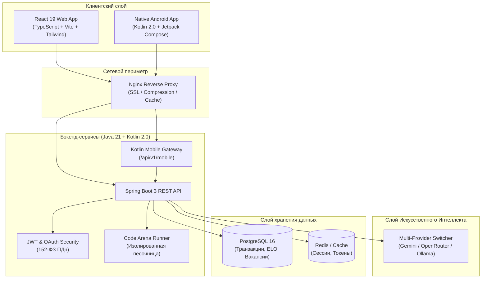

# Архитектура решения

Экосистема **FSP Career Arena** спроектирована по модульной микро-монолитной архитектуре с чётким разделением ответственности, высокой отказоустойчивостью и поддержкой бесшовного масштабирования.

---

## 🧱 Основные компоненты системы

### 1. Серверная часть (Backend)
- **Технологии**: Java 21 LTS + Kotlin 2.0.20 + Spring Boot 3.3.4.
- **База данных**: PostgreSQL 16 с версионированием миграций через Flyway.
- **Взаимодействие**: Полная совместимость смешанного кода Java и Kotlin без накладных расходов во времени выполнения (Zero-overhead interoperability).

### 2. Веб-интерфейс (Frontend)
- **Технологии**: React 19 + TypeScript + Vite + Tailwind CSS.
- **Типографика**: Фирменный моноширинный шрифт **JetBrains Mono** по официальному брендбуку ФСП.
- **Компоненты**: Интерактивная Арена с подсветкой синтаксиса, дашборды для соискателей и рекрутеров, модальные окна Телемоста.

### 3. Мобильный клиент (Android)
- **Технологии**: Kotlin 2.0 + Jetpack Compose (Material 3) + Clean Architecture + MVVM + StateFlow.
- **Сетевой слой**: Retrofit 2 + Moshi + OkHttp.

### 4. Интеллектуальный анализатор (AI Engine)
- Мультипровайдерная интеграция с поддержкой **Google Gemini**, **OpenRouter**, локальной **Ollama** и **YandexGPT**.
- Автоматический расчет соответствия кандидата техническим требованиям вакансии на основе структурированного JSON-промпта.
